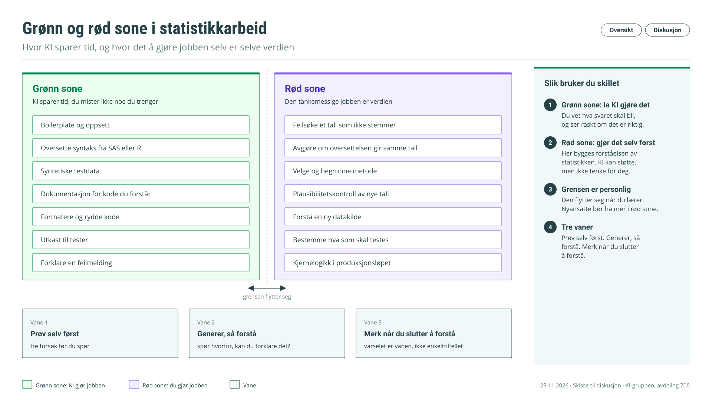

# Bevisst bruk

Nytt Nytt område i ki-praksis, kategori `bevisst`. Guidene merkes som forslag fordi de ikke har en ADR som kilde.

Det interessante spørsmålet er ikke om KI gjør oss raskere. Det er hva vi slutter å kunne når den gjør jobben for oss, og om det er noe vi har råd til å miste.

<figure class="figur" id="figur-3" markdown="span">
  [{ loading=lazy }](../figurer/3-bevisst-bruk.svg)
  <figcaption>Figur 3. Grønn og rød sone i statistikkarbeid · <a href="../figurer/3-bevisst-bruk.svg" download>Last ned SVG</a></figcaption>
</figure>

## Hvorfor dette har en egen del

Studier av utviklere som bruker KI peker i samme retning. De som delegerer blindt, forstår mindre av koden sin etterpå. De som stiller oppfølgingsspørsmål, forstår like mye eller mer. Og mange tror de jobber raskere med KI enn de faktisk gjør.[^1]

For et statistikkbyrå er dette mer enn et spørsmål om effektivitet. Kvaliteten på statistikken hviler på at noen forstår hvordan tallene blir til. Hvis den forståelsen gradvis flyttes ut av hodene våre og inn i verktøyene, svekkes noe vi ikke ser før det er borte.

## Forankring

Området har ingen egen ADR, og guidene står derfor som forslag. Men to vedtak peker i samme retning. [ADR0038](https://github.com/statisticsnorway/adr/blob/main/docs/0038-bruk-av-agentiske-kodeverktøy-i-applikasjonsutvikling.md) nevner behov for opplæring i riktig bruk som en negativ konsekvens av å ta verktøyene i bruk. Og [ADR0035](https://github.com/statisticsnorway/adr/blob/main/docs/0035-retningslinjer-for-sikker-koding.md) krever at utvikleren skal vite hvilke kommandoer og hvilken kode som kjører. Bevisst bruk handler om å holde den kunnskapen ved like.

## To sider

- **[Grønn og rød sone](soner.md).** En enkel måte å skille oppgaver der KI bare sparer tid, fra oppgaver der det å gjøre jobben selv er selve verdien. Med tre vaner som gjør skillet praktisk.
- **[KI-kompetanse](kompetanse.md).** Hva KI-forordningen krever av oss, og hvordan opplæringen i SSB henger sammen med dette nettstedet.

## Ikke en moralpreken

Dette handler ikke om å bruke KI mindre. Det handler om å bruke den der den gir mest, og å vite når du bør gjøre jobben selv. Grensen er personlig, og den flytter seg når du lærer.

[^1]: Nav oppsummerer to slike studier i artikkelen [Rammeverk for bevisst AI-bruk](https://ki-utvikling.nav.no/nyheter/bevisst-ai-bruk-rammeverk) (april 2026). Kildene bør sjekkes før de siteres videre.
