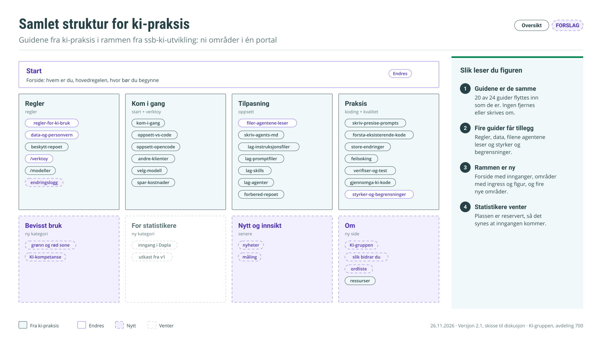

# Samlet struktur

Alle 24 guidene i ki-praksis, sidene om verktøy og modeller, og de nye delene fra ssb-ki-utvikling, plassert i én struktur med ni områder.

<figure class="figur" id="figur-0" markdown="span">
  [{ loading=lazy }](../figurer/0-samlet-struktur.svg)
  <figcaption>Figur 0. Samlet struktur for ki-praksis · <a href="../figurer/0-samlet-struktur.svg" download>Last ned SVG</a></figcaption>
</figure>

## Fra kategorier til områder

ki-praksis har i dag seks kategorier i `src/lib/guides.ts`: `start`, `verktoy`, `regler`, `koding`, `kvalitet` og `oppsett`. Forslaget gjør dem om til områder, med tre endringer:

- `start` og `verktoy` slås sammen til **Kom i gang**.
- `koding` og `kvalitet` slås sammen til **Praksis**, slik Nav gjør.
- `oppsett` får navnet **Tilpasning**, fordi guidene handler om filer som tilpasser agentene, ikke om installasjon.

To nye kategorier kommer til: `bevisst` og `statistiker`.

## Alle sider og guider

| Område | Side eller guide | Merke | Merknad |
|---|---|---|---|
| **Start** | Forside (`/`) | Endres | Innganger etter målgruppe og hovedregelen øverst |
| **Regler** | [regler-for-ki-bruk](https://ki-praksis.intern.ssb.no/praksis/regler-for-ki-bruk) | Endres | Vedtatte regler fra ADR0035 i en tabell, hovedregelen og figur 1 |
| | [data-og-personvern](https://ki-praksis.intern.ssb.no/praksis/data-og-personvern) | Endres | Tillegg om taushetsplikt og upubliserte tall |
| | [beskytt-repoet](https://ki-praksis.intern.ssb.no/praksis/beskytt-repoet) | Fra ki-praksis | |
| | Verktøy (`/verktoy`) | Endres | Datanivå og en egen gruppe for verktøy som venter |
| | Modeller (`/modeller`) | Fra ki-praksis | |
| | Endringslogg | Nytt | Kan bygges fra `updated` i guidene |
| **Kom i gang** | [kom-i-gang](https://ki-praksis.intern.ssb.no/praksis/kom-i-gang) | Fra ki-praksis | Blir inngangen for utviklere |
| | [oppsett-vs-code](https://ki-praksis.intern.ssb.no/praksis/oppsett-vs-code) | Fra ki-praksis | |
| | [oppsett-opencode](https://ki-praksis.intern.ssb.no/praksis/oppsett-opencode) | Fra ki-praksis | |
| | [andre-klienter](https://ki-praksis.intern.ssb.no/praksis/andre-klienter) | Fra ki-praksis | |
| | [velg-modell](https://ki-praksis.intern.ssb.no/praksis/velg-modell) | Fra ki-praksis | |
| | [spar-kostnader](https://ki-praksis.intern.ssb.no/praksis/spar-kostnader) | Fra ki-praksis | |
| **Tilpasning** | [filer-agentene-leser](https://ki-praksis.intern.ssb.no/praksis/filer-agentene-leser) | Endres | Figur 7 |
| | [skriv-agents-md](https://ki-praksis.intern.ssb.no/praksis/skriv-agents-md) | Fra ki-praksis | |
| | [lag-instruksjonsfiler](https://ki-praksis.intern.ssb.no/praksis/lag-instruksjonsfiler) | Fra ki-praksis | |
| | [lag-promptfiler](https://ki-praksis.intern.ssb.no/praksis/lag-promptfiler) | Fra ki-praksis | |
| | [lag-skills](https://ki-praksis.intern.ssb.no/praksis/lag-skills) | Fra ki-praksis | |
| | [lag-agenter](https://ki-praksis.intern.ssb.no/praksis/lag-agenter) | Fra ki-praksis | |
| | [forbered-repoet](https://ki-praksis.intern.ssb.no/praksis/forbered-repoet) | Fra ki-praksis | |
| **Praksis** | [skriv-presise-prompts](https://ki-praksis.intern.ssb.no/praksis/skriv-presise-prompts) | Fra ki-praksis | |
| | [forsta-eksisterende-kode](https://ki-praksis.intern.ssb.no/praksis/forsta-eksisterende-kode) | Fra ki-praksis | |
| | [store-endringer](https://ki-praksis.intern.ssb.no/praksis/store-endringer) | Fra ki-praksis | Kan få en figur over flyten senere |
| | [feilsoking](https://ki-praksis.intern.ssb.no/praksis/feilsoking) | Fra ki-praksis | |
| | [verifiser-og-test](https://ki-praksis.intern.ssb.no/praksis/verifiser-og-test) | Fra ki-praksis | |
| | [gjennomga-ki-kode](https://ki-praksis.intern.ssb.no/praksis/gjennomga-ki-kode) | Fra ki-praksis | |
| | [styrker-og-begrensninger](https://ki-praksis.intern.ssb.no/praksis/styrker-og-begrensninger) | Endres | Lenke videre til Bevisst bruk |
| **Bevisst bruk** | Grønn og rød sone | Nytt | Merkes som forslag, ingen ADR som kilde |
| | KI-kompetanse | Nytt | Kilde: KI-forordningen artikkel 4 |
| **For statistikere** | Inngang for statistikere som koder | Venter | Utenfor ADR0038. Lisens via S724 |
| **Nytt og innsikt** | Nyheter, måling | Nytt | Kan komme senere |
| **Om** | KI-gruppen, slik bidrar du, ordliste | Nytt | |
| | [ressurser](https://ki-praksis.intern.ssb.no/praksis/ressurser) | Fra ki-praksis | Flyttes hit fra guidene |

## Oppsummert

Av 24 guider flyttes 20 inn som de er, og 4 får et tillegg. Ingen guider foreslås fjernet eller skrevet om. Det meste av endringen ligger rundt guidene: forsiden, områdene og de nye delene.
