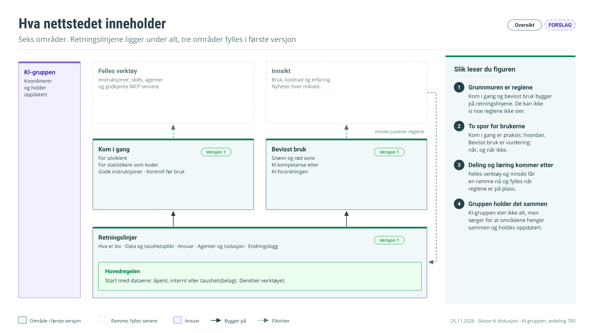

# KI-utvikling i SSB

KI-verktøy skriver allerede kode, forklarer feilmeldinger og foreslår tester hos oss. Det som mangler er et felles sted som sier hva som er lov, hvordan det gjøres godt, og hvor vi deler det vi lærer. Dette nettstedet er et forslag til et slikt sted.

!!! warning "Skisse til diskusjon"
    Dette er et utkast fra KI-gruppen i avdeling 700. Ingenting her er vedtatt. Regler og tabeller er merket Forslag der de er vårt forslag, og Avklares der vi ikke vet svaret ennå. Les det som et utgangspunkt for samtale, ikke som en instruks.

<figure class="figur" id="figur-0" markdown="span">
  [{ loading=lazy }](figurer/0-nettstedskart.svg)
  <figcaption>Figur 0. Hva nettstedet inneholder · <a href="figurer/0-nettstedskart.svg" download>Last ned SVG</a></figcaption>
</figure>

## Hvorfor et eget nettsted?

Fordi spørsmålene er de samme overalt, og svarene i dag ligger spredt. Kan jeg lime inn denne tabellen? Kan agenten kjøre kommandoer i terminalen min? Hvem har ansvaret hvis Copilot foreslo feilen? Hvilke instruksjoner bruker de andre teamene? Hver seksjon finner sine egne svar, og noen finner dem ikke.

Et nettsted gir tre ting en e-post eller et notat ikke gir. Det kan endres når verktøyene endres, og det gjør de nå omtrent hver måned. Det kan ha en endringslogg, så du ser hva som er nytt siden sist. Og det kan ligge åpent i et repo, der alle kan foreslå forbedringer.

## Hva du finner her

[Retningslinjer](retningslinjer/index.md)

Hva er tillatt, hvilke data som aldri skal inn i et KI-verktøy, og hvem som har ansvaret for resultatet.

[Kom i gang](kom-i-gang/index.md)

To innganger: én for utviklere, én for statistikere som skriver kode i Dapla. Begge ender i samme vane: kontroller før du bruker.

[Bevisst bruk](bevisst-bruk/index.md)

Når KI sparer tid, og når den tar fra deg forståelsen du trenger. Grønn og rød sone, tilpasset statistikkarbeid.

[Felles verktøy](katalog/index.md)

Instruksjoner, skills og MCP-servere som andre i SSB har laget og testet. Små, kuraterte, med eier.

[Innsikt](innsikt/index.md)

Hva vi måler om bruk, kostnad og erfaring, og månedlige nyheter om det som har endret seg.

[Om](om/index.md)

Hvem som står bak, hva gruppen skal gjøre, og hvordan du tar kontakt.

## Hvor bør du begynne?

| Du er … | Begynn her | Deretter |
|---|---|---|
| Utvikler i avdeling 700 | [Kom i gang for utviklere](kom-i-gang/utvikler.md) | [Agenter og isolasjon](retningslinjer/agenter.md) |
| Statistiker som koder i Dapla | [Kom i gang for statistikere](kom-i-gang/statistiker.md) | [Data og taushetsplikt](retningslinjer/data.md) |
| Leder | [Ansvar](retningslinjer/ansvar.md) | [KI-kompetanse](bevisst-bruk/kompetanse.md) |
| Usikker på om noe er lov | [Hva er lov, og hva er ikke lov](retningslinjer/tillatt.md) | Spør gruppen ([Om](om/index.md)) |
| Har laget noe andre kan bruke | [Slik bidrar du](katalog/bidra.md) | [Felles verktøy](katalog/index.md) |

## Inspirasjon

Strukturen er inspirert av Navs nettsted [ki-utvikling.nav.no](https://ki-utvikling.nav.no/), som samler retningslinjer, guider og felles tilpasninger for Copilot i Nav. Vi har tatt med det som passer for SSB og latt resten ligge. To forskjeller er viktige. Hos oss skriver mange statistikere kode, ikke bare utviklere. Og vår viktigste grense går ved taushetsbelagte statistikkdata og upubliserte tall, ikke bare ved personopplysninger i kode.
