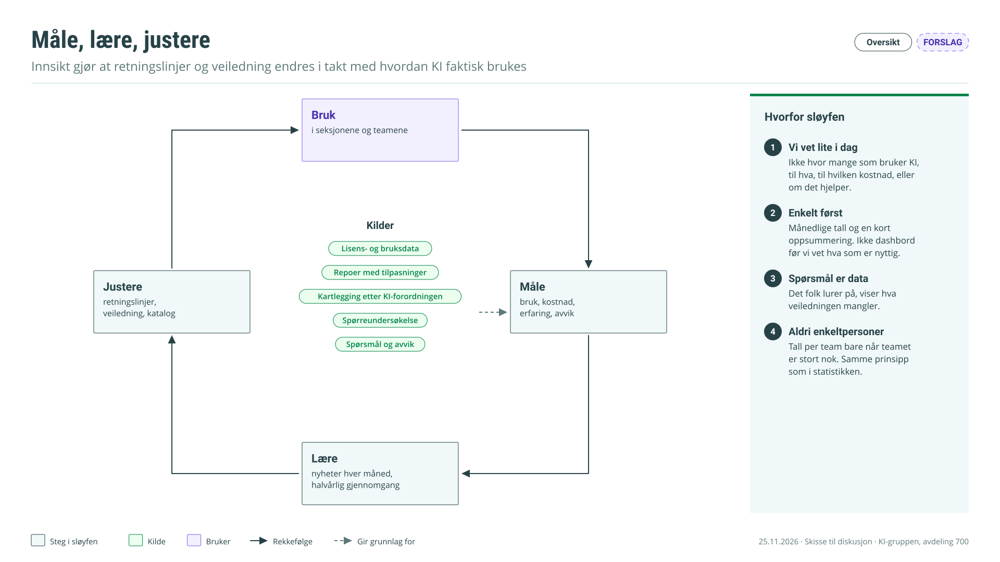

# Innsikt

Nytt Kan komme senere. Endringsloggen under Regler er den delen som kan lages først.

Vi vet lite om hvordan KI faktisk brukes i SSB. Ikke hvor mange som bruker det, ikke til hva, ikke hva det koster, og ikke om det hjelper. Denne delen skal gjøre det synlig, så både reglene og veiledningen kan bygge på erfaring og ikke bare antakelser.

<figure class="figur" id="figur-5" markdown="span">
  [{ loading=lazy }](../figurer/5-innsikt.svg)
  <figcaption>Figur 5. Måle, lære, justere · <a href="../figurer/5-innsikt.svg" download>Last ned SVG</a></figcaption>
</figure>

## Hvorfor måle

Ikke for å kontrollere enkeltpersoner. For å svare på spørsmål som angår alle:

- Bruker vi lisensene vi betaler for?
- Hvor gir KI mest, og hvor gir det lite?
- Hvor oppstår spørsmål og usikkerhet, og hva mangler i veiledningen?
- Får vi avvik, og hva lærer vi av dem?

## Innhold

- [Hva vi måler](maling.md): kildene, og hva vi ikke måler.
- [Nyheter](nyheter.md): en kort månedlig oppsummering av det som er endret.
