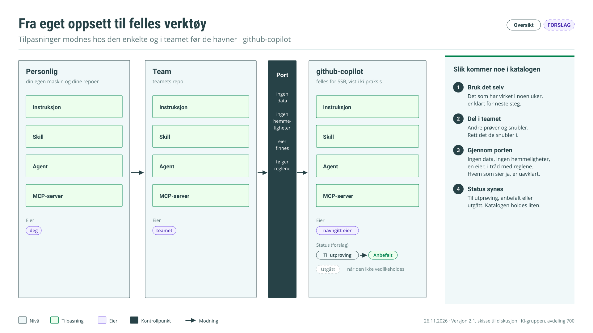

# Felles verktøy

Mange i SSB har allerede skrevet instruksjoner og skills som gjør KI-verktøyene bedre for nettopp vårt arbeid. Det meste ligger i private mapper og enkeltrepoer. Katalogen skal samle det som er verdt å dele, med en eier og en status.

<figure class="figur" id="figur-4" markdown="span">
  [{ loading=lazy }](../figurer/4-katalog.svg)
  <figcaption>Figur 4. Fra eget oppsett til felles verktøy · <a href="../figurer/4-katalog.svg" download>Last ned SVG</a></figcaption>
</figure>

## Fire typer tilpasning

| Type | Hva det er | Eksempel |
|---|---|---|
| **Instruksjon** | Tekst som alltid følger med til modellen i et repo eller en filtype | «Vi bruker pandas 2, testene ligger i `tests/`, kjør med `pytest`.» |
| **Skill** | En pakke med fremgangsmåte og eksempler for én type oppgave, som hentes fram ved behov | Lage figurer etter SSBs diagramstandard |
| **Agent** | En instruksjon med egen rolle og egne verktøy, for en større oppgave | En agent som går gjennom en pull request mot SSBs kodestandard |
| **MCP-server** | En kobling som gir KI tilgang til en tjeneste eller datakilde | Søk i statistikkbanken |

## Prinsipper for katalogen

- **Liten og kuratert.** Ti ting som brukes er bedre enn hundre som ikke gjør det.
- **Hver ting har en eier.** Noen som svarer på spørsmål og retter feil.
- **Status synes.** Til utprøving, anbefalt eller utgått.
- **Ingenting her inneholder data eller hemmeligheter.** Katalogen kan i prinsippet ligge åpent.

## Innhold

- [Instruksjoner og skills](tilpasninger.md)
- [MCP-servere](mcp.md)
- [Slik bidrar du](bidra.md)
