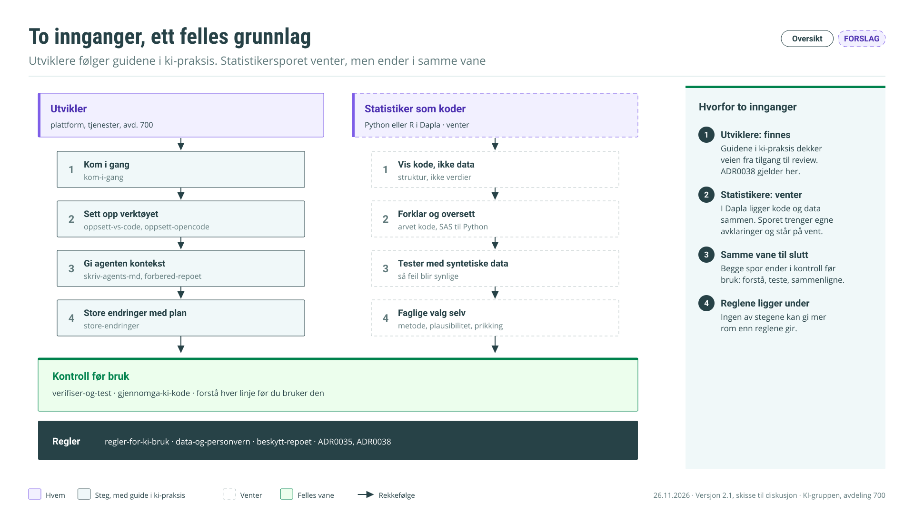

# Kom i gang

Fra lisens til første nyttige svar. Her setter du opp verktøyet, velger modell og lærer hva det koster. Er du ny, begynn med kom-i-gang-guiden og følg stegene i rekkefølge.

<figure class="figur" id="figur-2" markdown="span">
  [{ loading=lazy }](../figurer/2-kom-i-gang.svg)
  <figcaption>Figur 2. To innganger, ett felles grunnlag · <a href="../figurer/2-kom-i-gang.svg" download>Last ned SVG</a></figcaption>
</figure>

## Innhold i området

| Guide | Merke | Hva du finner |
|---|---|---|
| [kom-i-gang](https://ki-praksis.intern.ssb.no/praksis/kom-i-gang) | Fra ki-praksis | Fra tilgang til første oppgave |
| [oppsett-vs-code](https://ki-praksis.intern.ssb.no/praksis/oppsett-vs-code) | Fra ki-praksis | Copilot Chat og agentmodus i VS Code |
| [oppsett-opencode](https://ki-praksis.intern.ssb.no/praksis/oppsett-opencode) | Fra ki-praksis | Agent i terminalen |
| [andre-klienter](https://ki-praksis.intern.ssb.no/praksis/andre-klienter) | Fra ki-praksis | Zed, GitHub.com, og verktøy som er til avklaring |
| [velg-modell](https://ki-praksis.intern.ssb.no/praksis/velg-modell) | Fra ki-praksis | Hvilken modell til hvilken oppgave |
| [spar-kostnader](https://ki-praksis.intern.ssb.no/praksis/spar-kostnader) | Fra ki-praksis | Hva bruken koster, og hvordan holde den nede |

## To innganger

I dag er kom i gang skrevet for utviklere. Det er riktig, fordi ADR0038 gjelder applikasjonsutvikling. Statistikere som koder i Dapla, får sin egen inngang når statistikersporet starter. Se [For statistikere](../statistikere/index.md).

Endres Forslaget er at området sier dette tydelig øverst, så en statistiker ikke følger utviklerstegene og tror de gjelder i Dapla Lab.

## Etter oppsettet

Når verktøyet virker, er neste steg å gi det kontekst. Se [Tilpasning](../tilpasning/index.md).
