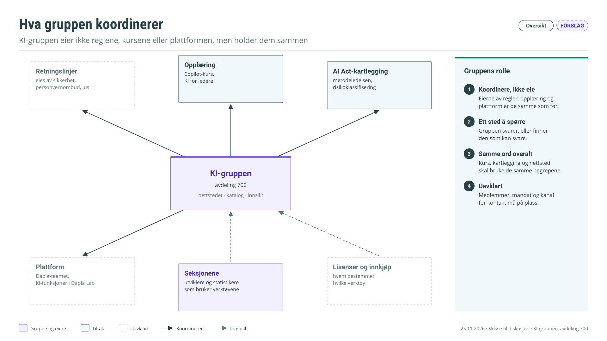

# Om KI-gruppen

KI-gruppen i avdeling 700 skal koordinere og følge opp KI-tiltakene i IT-avdelingen. Vi lager ikke alt selv. Vi sørger for at det som lages henger sammen, og at det er lett å finne.

<figure class="figur" id="figur-6" markdown="span">
  [{ loading=lazy }](../figurer/6-gruppen.svg)
  <figcaption>Figur 6. Hva gruppen koordinerer · <a href="../figurer/6-gruppen.svg" download>Last ned SVG</a></figcaption>
</figure>

## Hva vi gjør

- **Holder retningslinjene oppdatert**, i samarbeid med sikkerhet, personvernombud og jurister som eier dem.
- **Kuraterer katalogen** over felles instruksjoner, skills og MCP-servere.
- **Samler innsikt** om bruk og erfaringer, og skriver den månedlige oppsummeringen.
- **Svarer på spørsmål**, eller finner den som kan svare.
- **Kobler sammen** arbeidet med opplæring, kartleggingen etter KI-forordningen og plattformarbeidet i Dapla.

## Hva vi ikke gjør

Vi godkjenner ikke enkeltprosjekter og bestemmer ikke hvilke verktøy SSB kjøper. Det ligger der det ligger i dag. Vi gjør det enklere å vite hvor.

## Medlemmer

Avklares

## Kontakt

Avklares: kanal i Teams, e-post eller issues i dette repoet

## Om nettstedet

Nettstedet er bygget med MkDocs og ligger i et åpent repo. Alle kan foreslå endringer. Strukturen er inspirert av [ki-utvikling.nav.no](https://ki-utvikling.nav.no/).
