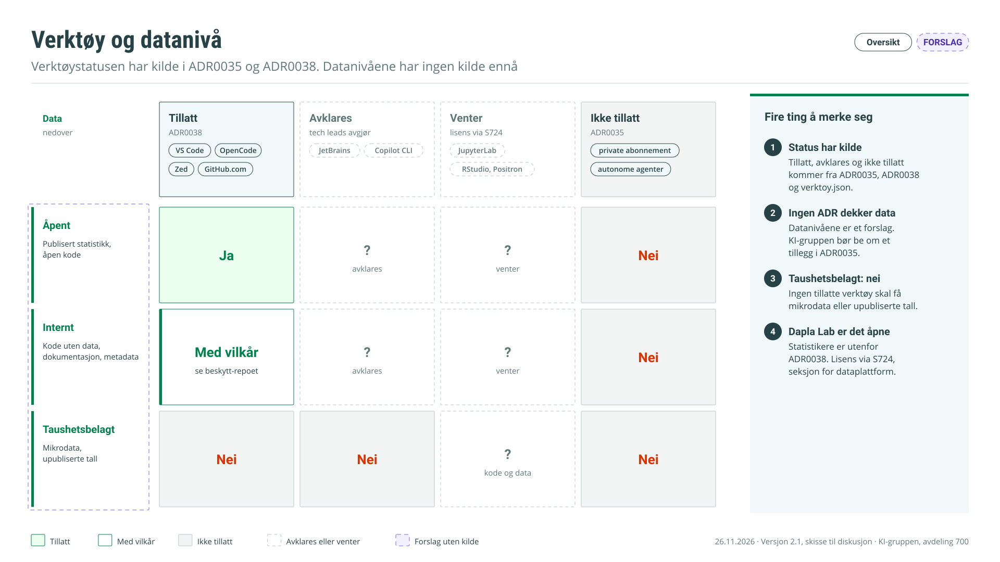

# Regler

Reglene svarer på tre spørsmål: hvilke verktøy du kan bruke, hvilke data som kan gå inn i dem, og hvordan du hindrer at noe lekker ut av repoet. Hver regel viser til kilden sin, som regel en arkitekturbeslutning (ADR). Det som ikke har en kilde, er merket som forslag.

<figure class="figur" id="figur-1" markdown="span">
  [{ loading=lazy }](../figurer/1-verktoy-og-datanivaa.svg)
  <figcaption>Figur 1. Verktøy og datanivå · <a href="../figurer/1-verktoy-og-datanivaa.svg" download>Last ned SVG</a></figcaption>
</figure>

## Innhold i området

| Side | Merke | Hva du finner |
|---|---|---|
| [regler-for-ki-bruk](https://ki-praksis.intern.ssb.no/praksis/regler-for-ki-bruk) | Endres | Reglene, med kilder. Forslag: tabellen over vedtatte regler, hovedregelen og figur 1 øverst |
| [data-og-personvern](https://ki-praksis.intern.ssb.no/praksis/data-og-personvern) | Endres | Personvern i kode. Forslag: tillegg om taushetsplikt, se [Data og taushetsplikt](data.md) |
| [beskytt-repoet](https://ki-praksis.intern.ssb.no/praksis/beskytt-repoet) | Fra ki-praksis | Hva agentene ikke skal få lese |
| [Verktøy](https://ki-praksis.intern.ssb.no/verktoy) | Endres | Tillatte verktøy. Forslag: datanivå, se [Verktøy og datanivå](verktoy.md) |
| [Modeller](https://ki-praksis.intern.ssb.no/modeller) | Fra ki-praksis | Modellene som er slått på for SSB |
| [Endringslogg](endringslogg.md) | Nytt | Hva som er endret, og når |

## Det som er vedtatt

Disse reglene står i [ADR0035](https://github.com/statisticsnorway/adr/blob/main/docs/0035-retningslinjer-for-sikker-koding.md), og gjelder med og uten KI-verktøy. De er vedtatt, og kan stå som regler i ki-praksis uten forbehold.

| Regel | Kilde |
|---|---|
| Bruk bare godkjente modeller, gjennom lisenser som administreres sentralt. Private abonnement er altså ikke tillatt. | ADR0035 |
| KI skal ikke arbeide på egen hånd. Agenten skal be om godkjenning før den gjør noe på maskinen din, og du skal vite hvilke kommandoer og hvilken kode som kjører. | ADR0035 |
| Du har alltid ansvaret for å kontrollere og godkjenne forslag og endringer. | ADR0035 |
| Du er like ansvarlig for koden uansett hvilket verktøy som skrev den. | ADR0035 |
| Minst ett annet teammedlem skal gå gjennom koden før den flettes til main. | ADR0035 |
| GitHub Copilot Business er løsningen for agentiske kodeverktøy. | ADR0038 |

## Det som mangler: data

**Ingen ADR sier hvilke data som kan gå inn i KI-verktøyene.** ADR0035 handler om sikker koding: tester, skanning, gjennomgang og drift. ADR0038 handler om valg av verktøy. Ingen av dem nevner taushetsplikt, personopplysninger, hemmeligheter eller upubliserte tall.

Forslaget til hovedregel fyller dette hullet:

**Start med dataene, ikke med verktøyet.** Et tillatt verktøy gjør ikke taushetsbelagte data trygge å lime inn. Spør først om dataene er åpne, interne eller taushetsbelagte. Deretter hvilket verktøy som er tillatt for dem.

Nytt Regelen er et forslag. Etter kildekravet i ki-praksis kan den ikke stå som regel før den har en kilde. Forslaget er derfor at KI-gruppen ber dem som har myndighet over ADR0035 (tech leads, Sikkerhetssenteret og seksjon for IT-arkitektur) om et tillegg om data. Se [Endringer](../forslag/endringer.md).

## Kildene

| ADR | Status | Dato | Myndighet | Gjelder |
|---|---|---|---|---|
| [ADR0035 – Retningslinjer for sikker koding](https://github.com/statisticsnorway/adr/blob/main/docs/0035-retningslinjer-for-sikker-koding.md) | Akseptert | 22.09.2025 | Tech leads, Sikkerhetssenteret, seksjon for IT-arkitektur | Applikasjonsutvikling i avdeling 700 |
| [ADR0038 – Bruk av agentiske kodeverktøy i applikasjonsutvikling](https://github.com/statisticsnorway/adr/blob/main/docs/0038-bruk-av-agentiske-kodeverktøy-i-applikasjonsutvikling.md) | Akseptert | 24.04.2026 | Tech Lead Forum, AM700 | Utviklere på ekspertteam med tech lead |

I tillegg: retningslinjene i [statisticsnorway/github-copilot](https://github.com/statisticsnorway/github-copilot).

Repoene er interne. Lenkene virker for dem som har tilgang til statisticsnorway på GitHub.
