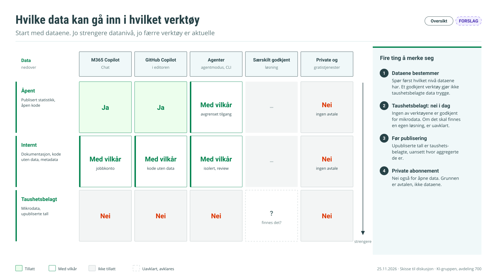

# Retningslinjer

Reglene her svarer på tre spørsmål: hvilke verktøy du kan bruke, hvilke data som kan gå inn i dem, og hvem som står ansvarlig for det som kommer ut. Resten av nettstedet bygger på disse tre.

!!! warning "Forslag"
    Alt på disse sidene er gruppens forslag. Det må forankres hos sikkerhet, personvernombud og ledelse før det kan gjelde. Punkter merket Avklares er ting vi ikke vet svaret på ennå.

<figure class="figur" id="figur-1" markdown="span">
  [{ loading=lazy }](../figurer/1-retningslinjer.svg)
  <figcaption>Figur 1. Hvilke data kan gå inn i hvilket verktøy · <a href="../figurer/1-retningslinjer.svg" download>Last ned SVG</a></figcaption>
</figure>

## Hovedregelen

**Start med dataene, ikke med verktøyet.** Et godkjent verktøy gjør ikke taushetsbelagte data trygge å lime inn. Spør derfor først hva slags data du arbeider med, og deretter hvilket verktøy som er godkjent for den typen data. Det eneste unntaket går motsatt vei: private abonnement og gratistjenester skal ikke brukes i jobben, heller ikke for åpne data. Det skyldes ikke dataene, men at SSB ikke har avtale med leverandøren.

Figuren over viser dette som en tabell: tre datanivåer nedover, fem typer verktøy bortover. Jo lenger ned, jo strengere.

## Fire ting alle bør vite

1. **Taushetsbelagte data og upubliserte tall skal aldri inn i et KI-verktøy** som ikke er særskilt godkjent for det. Det gjelder også «bare et lite utdrag» og «bare for å teste». Se [Data og taushetsplikt](data.md).
2. **Du er ansvarlig for det du tar i bruk**, uansett om du skrev det selv, kopierte det eller fikk det fra en KI. Se [Ansvar](ansvar.md).
3. **Bruk tjenestene SSB har avtale med**, ikke private abonnement eller gratisversjoner, også når de er bedre. Se [Hva er lov, og hva er ikke lov](tillatt.md).
4. **Agenter som kan kjøre kommandoer skal ha avgrenset tilgang.** En agent som kan lese hele hjemmeområdet ditt, kan også lese det du ikke tenkte på. Se [Agenter og isolasjon](agenter.md).

## Hvordan reglene holdes oppdatert

Verktøyene endrer seg raskere enn vanlige retningslinjer. Derfor har denne delen en [endringslogg](endringslogg.md), og hver side viser når den sist ble endret. Har du et spørsmål som ikke er besvart, er det et tegn på at siden mangler noe. Si fra (se [Om](../om/index.md)).
