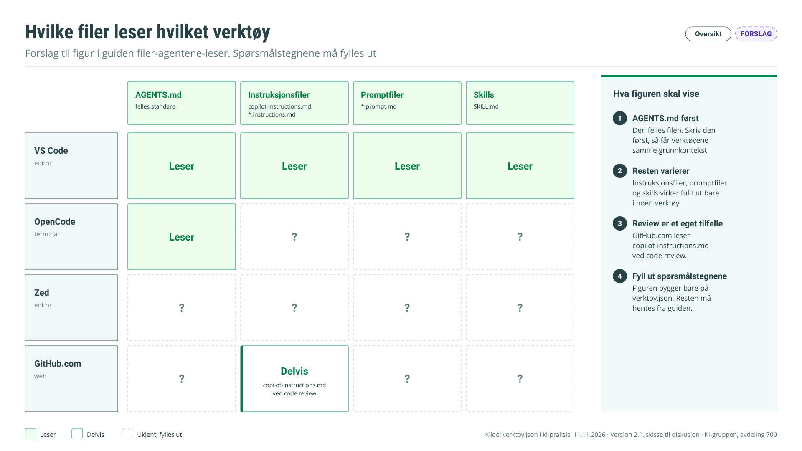

# Filer agentene leser

AGENTS.md, copilot-instructions.md, instruksjonsfiler, promptfiler, skills. Navnene ligner, og verktøyene leser ikke de samme. Figuren under er et forslag til hvordan guiden kan vise det på ett blikk.

Endres Forslag til figur i guiden [filer-agentene-leser](https://ki-praksis.intern.ssb.no/praksis/filer-agentene-leser).

<figure class="figur" id="figur-7" markdown="span">
  [{ loading=lazy }](../figurer/7-filer-agentene-leser.svg)
  <figcaption>Figur 7. Hvilke filer leser hvilket verktøy · <a href="../figurer/7-filer-agentene-leser.svg" download>Last ned SVG</a></figcaption>
</figure>

## Grunnlaget

Figuren bygger bare på beskrivelsene i `verktoy.json`:

- **VS Code** leser AGENTS.md, instruksjonsfiler, promptfiler og skills.
- **OpenCode** leser AGENTS.md.
- **GitHub.com** leser copilot-instructions.md ved code review.
- **Zed** har ingen opplysning.

Celler der vi ikke vet, står som «?». De må fylles ut fra guiden eller dokumentasjonen til verktøyet før figuren kan brukes. Det er også poenget: figuren viser hva guiden må svare på.

## Hva figuren skal få fram

1. **AGENTS.md er det felles minimumet.** Skriv den først, så får alle verktøyene samme grunnkontekst.
2. **Resten er verktøyspesifikt.** Instruksjonsfiler, promptfiler og skills virker fullt ut bare i noen verktøy.
3. **Review på GitHub.com er et eget tilfelle.** Den leser copilot-instructions.md, ikke AGENTS.md. Regler som skal gjelde i review, må stå der.
