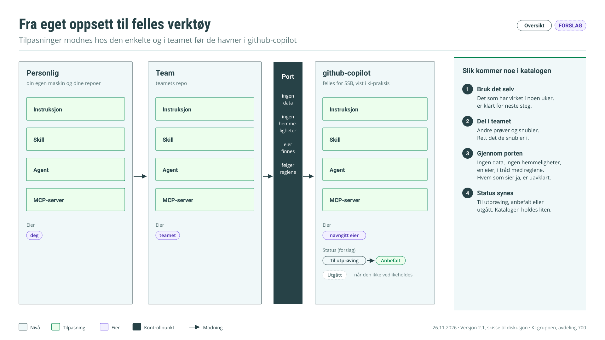

# Tilpasning

Uten kontekst gir agenten generiske råd. Med noen få filer i repoet vet den hvilke språk dere bruker, hvordan testene kjøres og hva den ikke skal røre. Her lærer du hvilke filer det er, og når du trenger hvilken.

## Innhold i området

| Guide | Merke | Hva du finner |
|---|---|---|
| [filer-agentene-leser](https://ki-praksis.intern.ssb.no/praksis/filer-agentene-leser) | Endres | Oversikten over filene. Forslag: figur 7, se [Filer agentene leser](filer.md) |
| [skriv-agents-md](https://ki-praksis.intern.ssb.no/praksis/skriv-agents-md) | Fra ki-praksis | Den felles filen alle verktøyene leser |
| [lag-instruksjonsfiler](https://ki-praksis.intern.ssb.no/praksis/lag-instruksjonsfiler) | Fra ki-praksis | Regler for et repo eller en filtype |
| [lag-promptfiler](https://ki-praksis.intern.ssb.no/praksis/lag-promptfiler) | Fra ki-praksis | Oppgaver du gjentar |
| [lag-skills](https://ki-praksis.intern.ssb.no/praksis/lag-skills) | Fra ki-praksis | Fremgangsmåter som hentes fram ved behov |
| [lag-agenter](https://ki-praksis.intern.ssb.no/praksis/lag-agenter) | Fra ki-praksis | Egne roller med egne verktøy |
| [forbered-repoet](https://ki-praksis.intern.ssb.no/praksis/forbered-repoet) | Fra ki-praksis | Før agentene slippes løs |

## Felles tilpasninger

Eksemplene og de felles filene ligger i [statisticsnorway/github-copilot](https://github.com/statisticsnorway/github-copilot). Det er SSBs katalog. Guidene i ki-praksis viser kopier av filene derfra, så eksemplene alltid er de samme som teamene faktisk bruker.

<figure class="figur" id="figur-4" markdown="span">
  [{ loading=lazy }](../figurer/4-katalog.svg)
  <figcaption>Figur 4. Fra eget oppsett til felles verktøy · <a href="../figurer/4-katalog.svg" download>Last ned SVG</a></figcaption>
</figure>

Nytt Forslag: en kort tekst om hvordan en tilpasning går fra eget repo til github-copilot, og hvem som sier ja. Det står i dag ingen steder for den som ikke leser README-ene.
